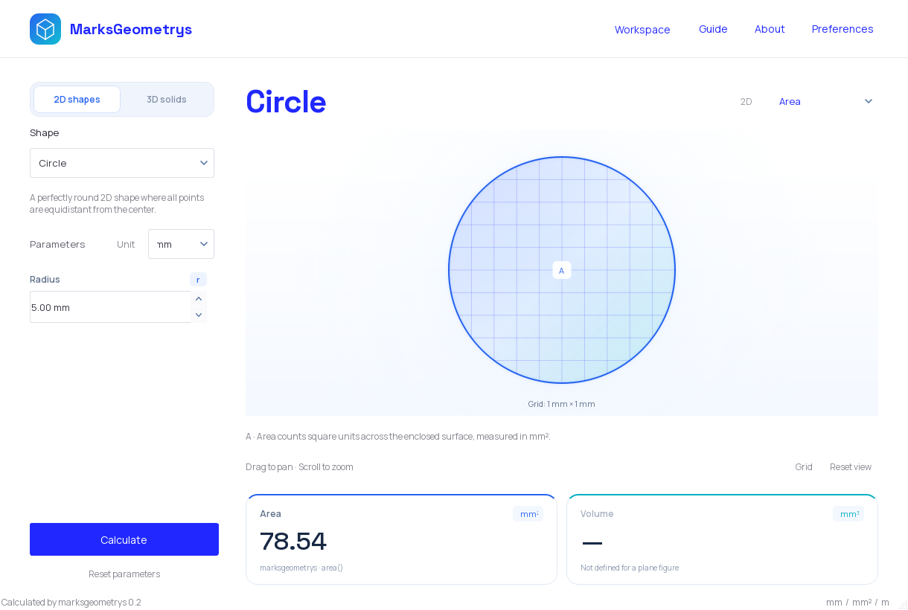
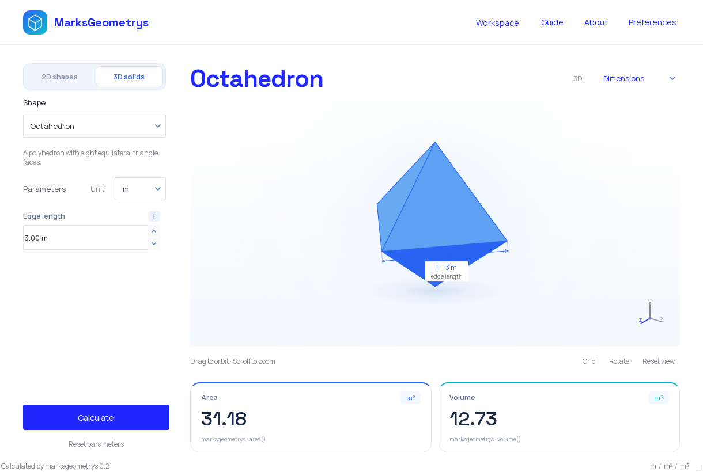

# MarksGeometrys

A desktop interface for the [marksgeometrys](https://pypi.org/project/marksgeometrys/) Python library. Select a plane figure or solid, adjust its dimensions, and explore the geometry alongside the library's area and volume results.




## Run

```powershell
python -m venv .venv
.\.venv\Scripts\Activate.ps1
python -m pip install -e .
python -m marksgeometrys_ui
```

The `marksgeometrys-ui` and `mgui` commands are also available.

## Calculations belong to marksgeometrys

The interface requires **marksgeometrys 0.2 or later**. Every displayed area and volume comes directly from the installed library through its numeric `area()` and `volume()` methods, including `Sphere.volume()`. The interface does not replace results with its own formulas or modify the library.

`calculations.py` validates inputs, derives dependent lengths, supplies the library's constructor arguments, and accepts numeric results without parsing unit-suffixed strings. Integer and floating-point results are supported; decimal dimensions and results are preserved. Required base areas also come from the library's own 2D classes. `library_parameters()` exposes the exact constructor arguments for inspection.

Version **0.2 fixes octahedron calculations**: all 25 configured shapes now produce numeric area results, and all 17 solids produce numeric volume results. The library also provides `area_formatted()` and `volume_formatted()` for callers needing unit-suffixed text; this interface uses the numeric methods and displays units separately. Results are displayed unchanged. Unexpected library failures are reported, and a successful measurement is retained if the other one fails.

Some constructors require redundant inputs. The interface derives apothems and slant heights from the visible geometry; rectangular prisms use the entered third edge as the constructor's duplicate height. The legacy pyramid receives the base edge for both rectangular base-side arguments, and the trapezoidal prism's additional `pbase` length is the mean of its two parallel bases. No equivalent-area arguments are substituted to alter the library's results.

## Explore the figure

The **Dimensions / Area / Volume** selector changes the visual explanation:

- **Dimensions:** symbols next to inputs correspond to dimension arrows attached to the figure. In 3D, the annotations move with the camera.
- **Area:** the plane figure's enclosed region is highlighted with a clipped scale grid; solids highlight their exterior faces.
- **Volume:** solids reveal layers inside their transparent surface. Plane figures have no volume, so the 2D view shows an illustrative unit cube representing 1 cm³.

The illustrations explain what the measurements mean. They do not calculate or substitute the library's numeric results. Grid spacing is labelled and adapts to large dimensions; the unit cube is a separate explanatory example.

Drag to pan in 2D or orbit in 3D, and scroll to zoom. **Reset view** restores the camera. **Preferences** contains animation, dimension-label, and wireframe options. Animations stop when hidden and can be disabled.

The existing white layout is retained, with **Space Grotesk** display headings and **Manrope** controls, subtle blue accents, and softly shaded canvases. Both fonts are bundled with their SIL Open Font Licenses and do not require installation on the user's computer. Parameter changes and numeric results animate from their current displayed values, including when edits interrupt an animation. Inputs, labels, help, errors, documentation, and source comments are in English. Both viewports use Qt painting and work without PyOpenGL or an OpenGL context.

## Shapes

- **2D:** circle, square, rectangle, triangle, rhombus, parallelogram, trapezoid, regular polygon.
- **3D:** cube, sphere, cylinder, cone, cone frustum, pyramid, pyramid frustum, tetrahedron, octahedron, dodecahedron, icosahedron, rectangular prism, quadrangular prism, regular polygon prism, rhomboidal prism, triangular prism, trapezoidal prism.

The **Unit** selector offers **mm, cm, m, km, in, ft, yd, and px**, and accepts custom labels such as **µm**. The selected unit is passed to every `marksgeometrys` constructor, including the library primitives used for base areas. Input suffixes, dimension annotations, area grids, unit cubes, results, and help all follow the selection; areas use `unit²` and volumes use `unit³`. Side counts remain unitless.

As in the library, choosing a unit interprets the entered numbers in that unit; it does **not** convert their magnitudes. Changing the selection clears previous results, and the unit is retained when switching shapes or resetting parameters. The initial unit is **cm**.

A shared symbol registry keeps input labels and graphical annotations consistent. Polygon bases are regular; triangular and trapezoidal prism drawings use symmetric bases. Dependent dimensions are derived for the library's required constructor inputs. The original blue-and-turquoise cube logo is used in the header and window icon.

## Keyboard shortcuts

| Shortcut | Action |
| --- | --- |
| Ctrl+Enter | Calculate using marksgeometrys |
| Ctrl+R | Reset parameters |
| Ctrl+0 | Reset the view |
| F1 | Guide |
| Ctrl+Q | Close |

## Verification

Tests use Python's built-in `unittest` and Qt's offscreen platform:

```powershell
python -m unittest discover -s tests -v
python -m compileall -q src tests
```

Coverage includes library-call provenance for all 25 shapes, unchanged real-library results, upstream failures without local fallbacks, constructor arguments, validation, actual 3D meshes, camera interactions, projected dimension annotations, measurement modes, English controls, reduced motion, and compact layouts.

## Source

```text
src/marksgeometrys_ui/
    main_window.py    # Layout, navigation, actions, and application state
    widgets.py        # Shape selection, parameters, and animated results
    theme.py          # White workspace and typography
    typography.py     # Bundled Space Grotesk and Manrope fonts
    viewer_2d.py      # Plane geometry and measurement explanations
    viewer_3d.py      # Meshes, projected dimensions, interior layers, and camera
    calculations.py  # Strict adapter for marksgeometrys
    symbols.py       # Shared dimension symbols
    shapes.py        # Shape catalogue and independent dimensions
    assets/          # Vector control icons and licensed font files
tests/               # Library, viewport, control, and integration tests
```

MIT license. Built with [marksgeometrys](https://pypi.org/project/marksgeometrys/) and [PyQt6](https://www.riverbankcomputing.com/software/pyqt/).
